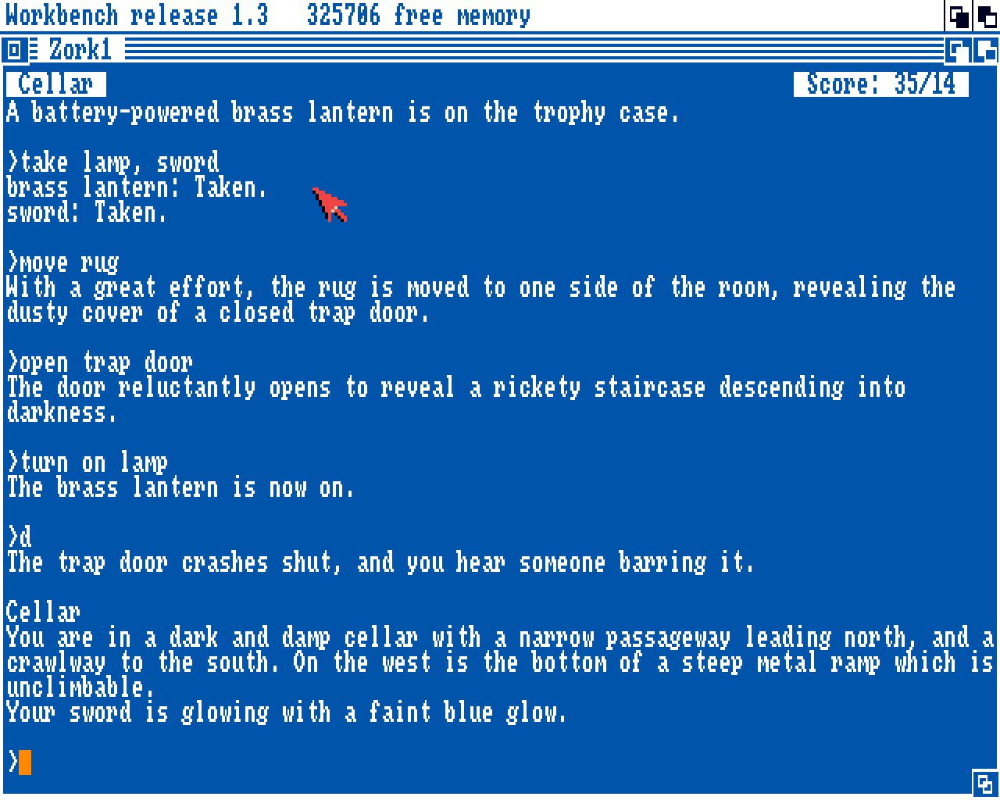
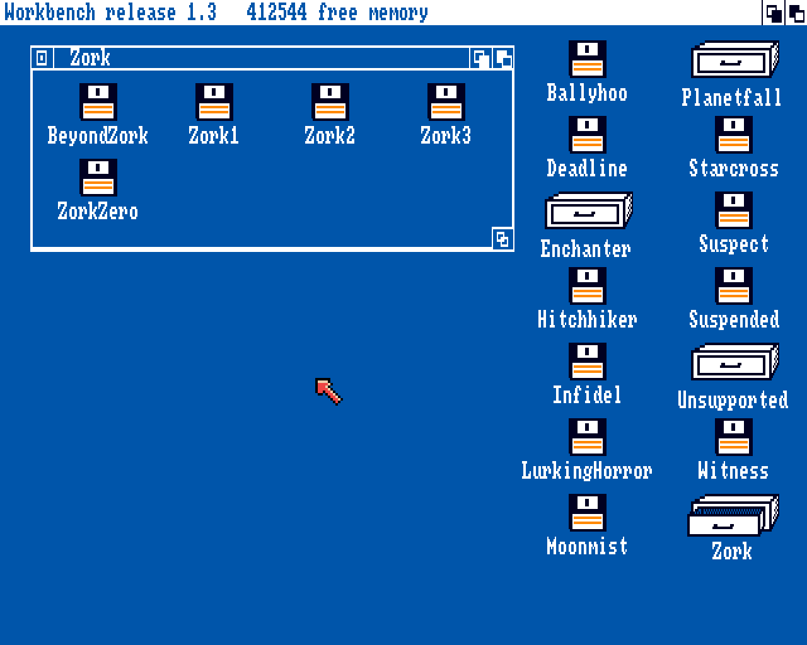
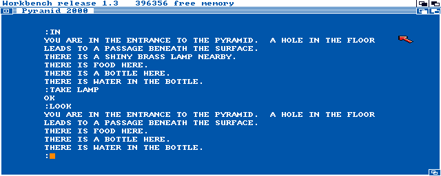

# infocom-remake

Play Infocom story files in a Unity app that looks like Amiga Workbench 1.3.

## Set up

1. Clone this repository.
2. In Unity Hub choose **Add > Add project from disk** and pick the repository folder. The project is pinned to **Unity 6000.6.9f1** (newest Unity 6.6 release as of November 2026; see `ProjectSettings/ProjectVersion.txt`), so Hub will offer to install it. On first open Unity fills in the rest of `ProjectSettings`, creates `Packages` and a `.meta` file for each asset; commit those.
3. Make a folder called `Games` in the repository root (beside `Assets`; Unity creates it on first run if you skip this) and copy your story files into it: `.z3`, `.z4`, `.z5`, `.z6`, `.dat` or `.data`. The icon label is the file name, so rename them how you like (for example `Zork I.z3`). `Games` and `Saves` are ignored by git, so story files never get committed.
   For Zork Zero, also copy `Pic.data` from the Amiga Zork Zero disk into `Games`, named like the story with `.pic` on the end (for example `Zork Zero.z6` and `Zork Zero.pic`). A file just called `Pic.data` in the same folder works too.
   TRS-80 machine-language programs also run: copy a Level II SYSTEM cassette image (`.cas`) or a TRSDOS `/CMD` file (`.cmd`) into `Games` too. See [TRS-80 programs](#trs-80-programs).
4. Press Play. No scene setup is needed: the Workbench starts by itself in any scene.

For a full-screen app: File > Build Settings > Windows, then Build. Put the `Games` folder next to the built `.exe`.

## Using it

- Double-click a disk icon to start that story. Several can run at once.
- Icons are in alphabetical order on the right-hand side of the screen: A at the top of the leftmost column, each column running down and then moving right, so the Z titles end up in the bottom-right corner.
- Series get a drawer: Zork (Zork I-III, Zork Zero, Beyond Zork), Enchanter (Enchanter, Sorcerer, Spellbreaker) and Planetfall (Planetfall, Stationfall). Double-click a drawer to open a window of its games. Matching ignores case, spaces and punctuation, so `Zork1.z3` and `Zork I.z3` both go in. A drawer appears once two games of a series are there; the list is `KnownSeries` in `Core/Workbench.cs`.
- Any folder inside `Games` that holds story files is a drawer too, so you can make your own groups. A folder named like a series (for example `Games/Zork`) gets that series' loose games added to it.

- Drag windows by the title bar. The top-right gadgets send a window to the front or back, the top-left one closes it, and the bottom-right one resizes it.
- Hold the **right mouse button** for the menu bar: **Workbench** (Open, Rescan games, About, Quit), **Story** (Save, Restore, Restart, Quit story, Close window), **Display** (PAL 640x256, NTSC 640x200, Tall pixels).
- Typing: Up and Down recall earlier commands. Page Up/Page Down or the mouse wheel scroll back. Any key continues past `[MORE]`.
- Saves go in a `Saves` folder beside `Games`. You're asked for a file name, as in the originals.

## TRS-80 programs

Pyramid 2000 (Radio Shack, 1979) and similar TRS-80 Model I/III programs run in their own Workbench window on a 64 x 16 TRS-80 screen.

- Use the Level II cassette image, for example `PYRMD.CAS`, renamed how you like (`Pyramid 2000.cas`). The Level I tape (`pyrm2kl1.cas`) won't load.
- No TRS-80 ROM is needed. The player stands in for the ROM routines the program calls: print a character, read the keyboard and the cassette.
- Pyramid shows its title and waits for a key before it starts, as on the real machine. Letters are typed as capitals. Up and Down recall earlier commands.
- SAVE and LOAD use a virtual cassette. You're asked for a file name, and the tape goes in `Saves` (`pyramid 2000.sav` by default).
- In the **Story** menu, Restore types LOAD and Restart loads the program again from the start.

## What's inside

| Folder | What it does |
|---|---|
| `ZMachineLib/` | Based on Brian Peek's MIT-licensed C# Z-machine, reworked against the Z-Machine Standard 1.1 for versions 1-6: version 6 opcodes and windows, output stream 3, catch/throw, undo, timed input, custom alphabets, dictionary lookup by encoded text, a binary save format, and fixes to object removal, properties and attributes. |
| `Core/` | Plain C#, no Unity: the 640-pixel indexed frame buffer, Topaz font, game windows, Workbench desktop, menus, Guru Meditation alert. |
| `Core/V6Screen.cs`, `Core/V6Session.cs` | The version 6 screen: eight pixel windows the game lays out itself, drawn in Topaz, with the Z-machine colours, pictures, [MORE], and mouse clicks. A version 6 story gets its own full screen, as on the Amiga; **Story > Workbench to front** goes back to the desktop. |
| `Core/AmigaPictureFile.cs` | Reads Infocom's Amiga picture file (`Pic.data`): the directory, palettes, and the Huffman-coded, run-length, row-XORed picture data. The format is described at the top of the file. |
| `Trs80/` | A Z80 processor (passes the ZEXDOC instruction test), the `.cas`/`.cmd` loader, and the TRS-80 session: screen, keyboard and cassette in place of the ROM. A program that calls a ROM routine the player doesn't have stops with the Guru Meditation alert, naming the address. |
| `Unity/WorkbenchHost.cs` | The only Unity code: turns the frame buffer into a texture, scales it by whole pixels, and passes mouse and keys in. |

## Known limits

- Version 6 games (Zork Zero, Shogun, Journey, Arthur) need the Amiga picture file for their pictures. Only Zork Zero has been tested. Without pictures Zork Zero still plays, but as text only, with no status bar.
- Version 4 and 5 games (A Mind Forever Voyaging, Trinity, Beyond Zork, Border Zone, Sherlock, and others) may hit bugs. If one does, the Guru Meditation alert shows and the error is printed in the game window.
- No sound effects (only The Lurking Horror and Sherlock used them).
- Desktop and window details are a first pass and will be tuned against real Workbench 1.3 screenshots.

## Credits

- ZMachineLib (c) 2016 Brian Peek, MIT licence (`ZMachineLib/LICENSE.txt`).
- Topaz font data from TrueSchool Ascii's Multi Platform Amiga Fonts v1.02 by dMG/t!s^dS!, GPL with font exception. Topaz is (c) Amiga Inc.
